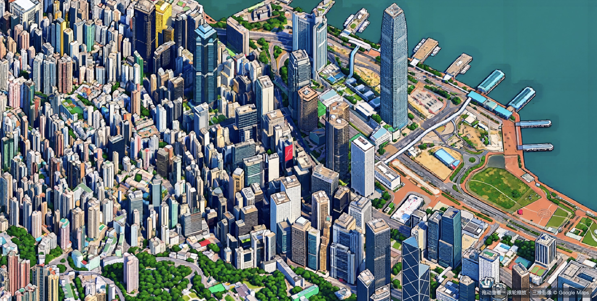
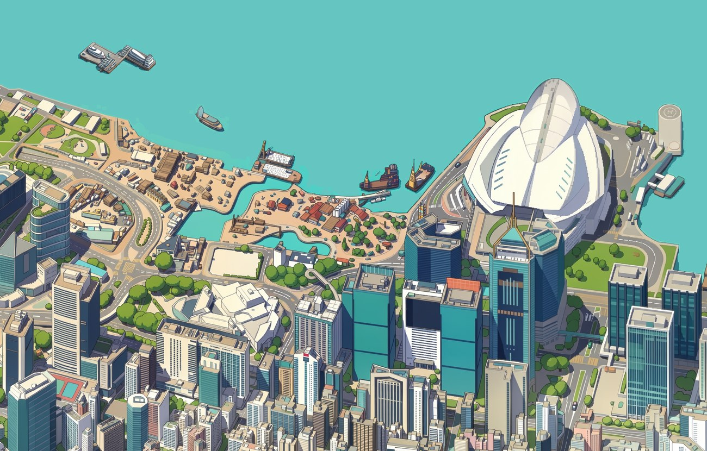
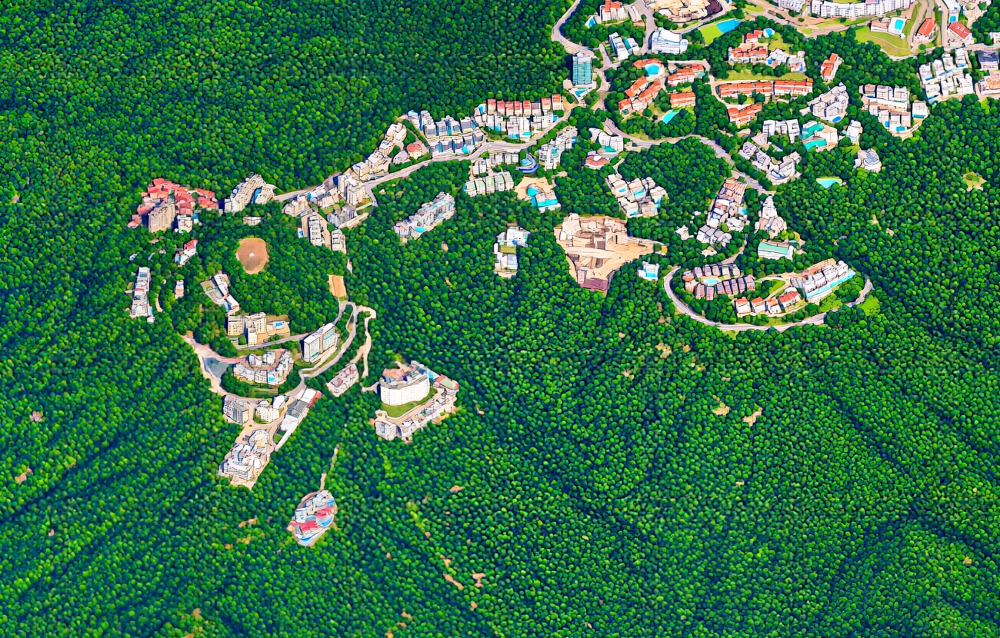
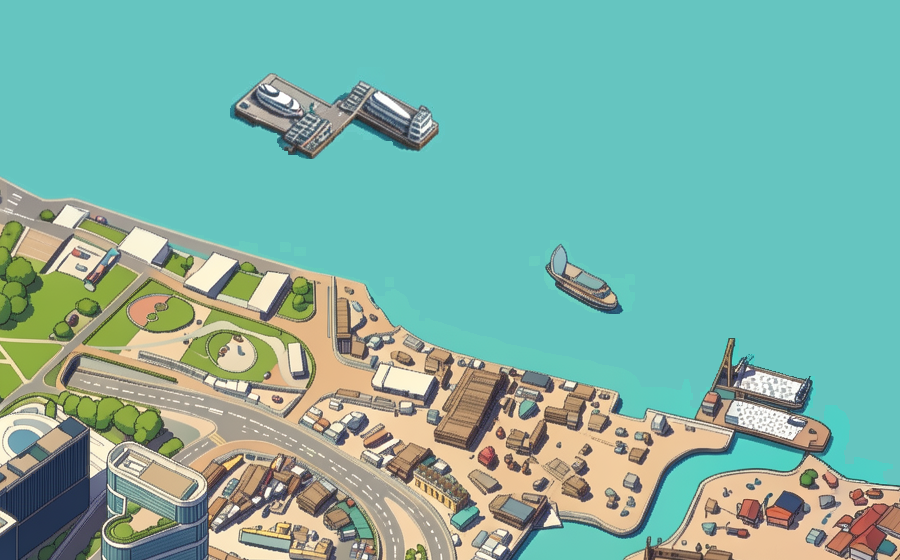

# Hong Kong Island, drawn as an isometric pixel-art map

A hand-drawn-looking map of Hong Kong Island that runs **completely offline**:
the viewer reads local Deep Zoom tiles and nothing else. Drag to pan, scroll to
zoom — at 100% every building is flat colour and a one-pixel ink edge.



- 6144 × 4096 pixels, covering the island's north shore from Kennedy Town to
  Chai Wan, plus a corner of Kowloon across the harbour
- 129 tiles (z0–z4); crisp pixel grid at 1:1, no blur when you zoom in
- The same pipeline drops onto any other piece of ground — only the base render
  changes

## Gallery

**Sheung Wan / Sai Ying Pun.** Blocks climbing the slope, streets cut into
staircases of buildings:


**Wan Chai North.** The convention centre juts into the harbour; berths, barges
and building sites are all still where they belong:



**Happy Valley.** The racecourse oval is the easiest landmark on the island to
recognise:


**The Peak.** Winding access roads, housing estates, a reservoir on the ridge;
the mountain is left to tree crowns and contour lines:



**100%, no downscaling.** Flat colour blocks, trees as clumps, verticals that
stay vertical:



## Run it

```
node hk/serve.mjs 8130
open http://127.0.0.1:8130/hk/map.html
```

Drag to move, scroll to zoom, `0` to fit, `+` / `-` for one zoom step.

## Where it comes from

The image is a redraw: Google Photorealistic 3D Tiles shot through one
orthographic camera, then repainted by an image model over the whole canvas at
once. How that is set up, why it does not leave seams, and the numbers that back
that claim are in [arch.md](arch.md).

3D imagery © Google Maps. This is a derived, restyled image made for a technical
demo — it is not a map and must not be used as one.
